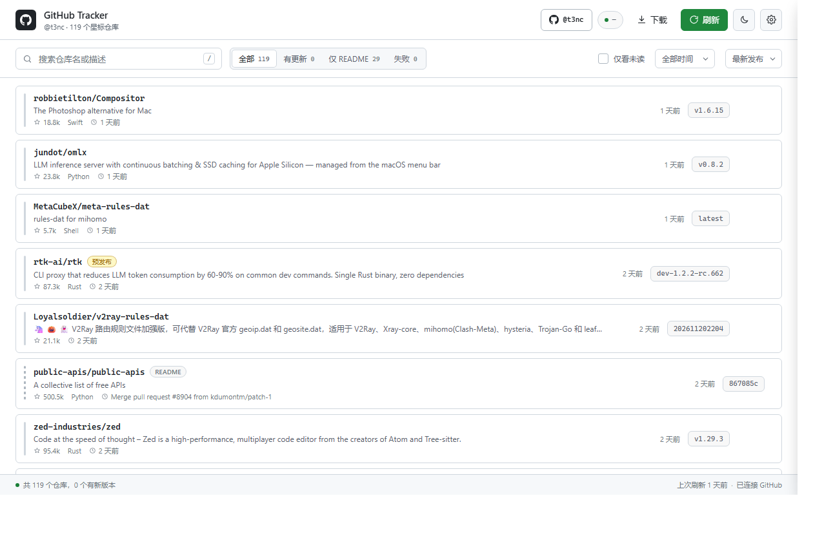
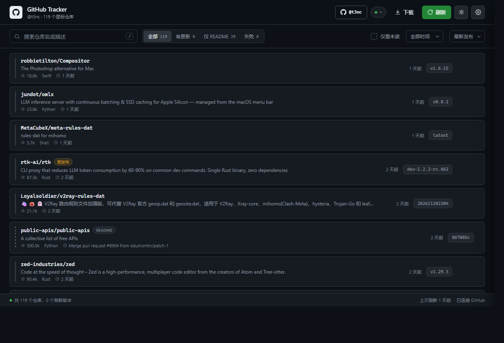
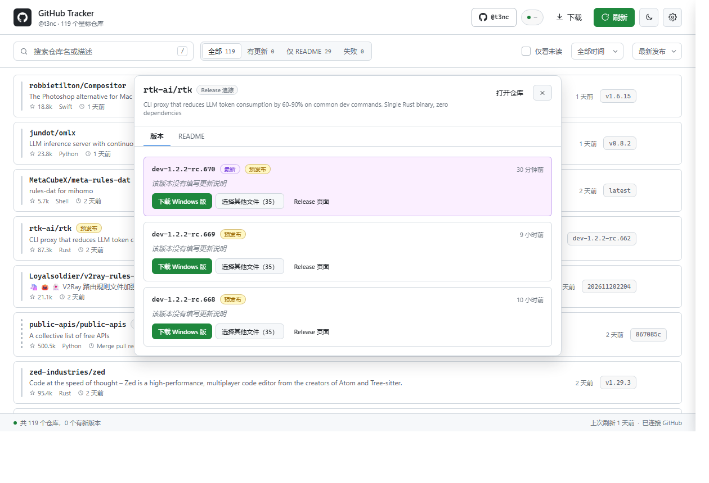
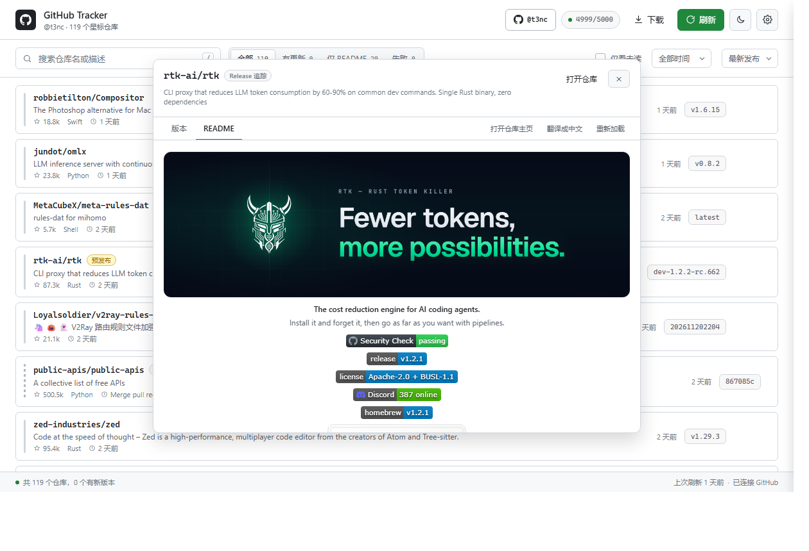

# MyGithubTracker

> 只关心 GitHub 星标项目「有没有发新版」的 Windows 桌面小工具。

你 star 了几百个项目，但真正想知道的往往只有一件事：**哪些仓库最近发了新版本**。GitHub 的通知不区分 Release，批量下载也不方便。这个工具把「检查更新」收成一张表：一眼看到谁更新了，点开看改了什么，一键下载 Windows 安装包。

单文件 exe，双击即用；纯 Go 实现，不依赖 Go / Node / 运行库，界面由系统自带的 Edge 渲染。



## 功能

| | |
| --- | --- |
| **更新追踪** | 有 Release 的仓库追最近 N 个版本；没有 Release 的自动改为追踪 `README.md` 的最近提交 |
| **增量刷新** | 本地保存 ETag，命中 `304 Not Modified` 时不计入 API 配额，日常刷新几乎零成本 |
| **不会误报** | 首次同步只建立基线，历史版本不会被标成「新版本」；之后有变化才标红 |
| **时间筛选** | 全部 / 24 小时 / 7 天 / 30 天 / 90 天内有过更新 |
| **版本详情** | 点击卡片查看最近 N 个（1–5，默认 3）版本的更新说明与附件，一键下载或跳到 Release 页 |
| **README 预览** | 点击仓库名直接看 README，渲染与 GitHub 一致（Markdown + 安全 HTML），相对图片/链接自动补全 |
| **一键翻译** | 英文更新说明与 README 可翻译成中文，支持 AI 接口与浏览器内置两种引擎 |
| **下载管理** | 进度、速度、取消、失败重试、同名文件自动去重 |
| **明暗主题** | 与 GitHub 网页版一致的配色，支持浅色 / 深色 / 跟随系统 |
| **代理** | 跟随系统 / 不使用 / 自定义 `http(s)`、`socks5`，API 与下载共用 |

## 界面

| 深色主题 | 版本详情 |
| --- | --- |
|  |  |

README 预览（右侧按钮固定在页签行，长文档滚动时不跟着走）：



更多介绍见 [docs/INTRO.md](docs/INTRO.md)。

## 快速开始

1. **下载**：从 [Releases](https://github.com/t3nc/MyGithubTracker/releases) 获取 `MyGithubTracker.exe`；也可以按下面的「构建」自行编译。
2. **准备 Token**：打开 <https://github.com/settings/tokens/new?scopes=read:user&description=MyGithubTracker>，勾选 `read:user`（需要读取私有仓库的星标再加 `repo`），生成后复制。
3. **粘贴 Token**：首次启动会弹出引导窗口，粘贴后点「保存并开始」。程序会自动拉取星标仓库并检查更新。

> 首次同步只建立基线，列表不会立刻全是红点；之后有新版本才会标记。

## 使用说明

| 操作 | 说明 |
| --- | --- |
| 刷新 | 顶栏「刷新」，增量刷新；按住 <kbd>Shift</kbd> 点击可忽略 ETag 强制全量 |
| 筛选 | 全部 / 有更新 / 仅 README / 失败，可与时间范围、搜索、排序叠加 |
| 排序 | 默认按最近更新时间倒序（Release 发布时间或 README 提交时间），也可按 Star 数、名称排序 |
| 查看详情 | 点击卡片，查看最近 N 个版本的更新说明与附件 |
| 查看 README | 点击卡片里的仓库名，直接切到 README 页签 |
| 下载 | 卡片行内下载按钮或详情里的「下载 Windows 版」，自动匹配 windows / x64 / exe / msi / zip |
| 选择其他文件 | 详情里展开全部附件手动挑选 |
| 已读 | 标记后该版本不再算「新版本」，下载完成后也会自动标记 |
| 快捷键 | <kbd>/</kbd> 搜索 · <kbd>Esc</kbd> 关闭弹窗 · <kbd>Ctrl</kbd>+<kbd>,</kbd> 设置 · <kbd>Ctrl</kbd>+<kbd>Shift</kbd>+<kbd>L</kbd> 切换主题 |

## 内容翻译

英文内容可以一键翻译成中文，版本说明和 README 都支持。译文按 Markdown 渲染，保留标题、列表与代码块结构。

设置 → 内容翻译 → 翻译引擎：

| 引擎 | 说明 |
| --- | --- |
| **AI 接口**（默认） | 调用任意 OpenAI 兼容服务，需要自行填写 API 地址与 Key；质量更稳定 |
| **浏览器内置** | 使用 Edge / Chrome 自带的本地翻译模型，不需要 Key、不消耗接口配额；需要 Chromium 138+，首次使用会下载中英语言包 |

AI 引擎配置项：

| 项 | 说明 |
| --- | --- |
| API 地址 | OpenAI 兼容服务的根地址，如 `https://token.sensenova.cn/v1`；会自动补 `/chat/completions`，粘贴完整地址也能识别 |
| API Key | 必填，只保存在本机。未配置时点翻译会提示并打开设置面板 |
| 模型 | 可手填，也可点「获取模型」从 `{base}/models` 读取候选 |

- 翻译请求与 GitHub 请求共用同一套代理设置。
- AI 引擎对超长内容按段翻译后拼接；相同内容 2 小时内不重复请求。
- 浏览器引擎的翻译完全在本机完成，不发送任何内容。

> 程序不内置任何 API Key，首次使用翻译前需要自己填写。

## 设置项

| 分组 | 项目 |
| --- | --- |
| 账号 | GitHub Token、测试连接（返回账号、剩余配额、延迟） |
| 网络代理 | 跟随系统 / 不使用 / 自定义 |
| 下载 | 下载目录（可用系统文件夹选择框）、并发检查数 |
| 列表 | 最近版本数（1–5）、隐藏我自己创建的仓库 |
| 内容翻译 | 翻译引擎、API 地址 / Key / 模型 |
| 外观 | 浅色 / 深色 / 跟随系统 |

「隐藏我自己创建的仓库」按仓库 owner 与你的 GitHub 登录名比对，登录名未知时不做过滤；命中后状态栏会提示「已隐藏 N 个自己的仓库」。

## 数据与隐私

所有数据只保存在本机，不上传任何信息：

```
%APPDATA%\MyGithubTracker\
├── config.json       # Token、代理、下载目录等配置（权限 0600）
├── state.json        # 各仓库的追踪状态与缓存（不含 Release 正文）
├── app.log           # 运行日志（5MB 轮转）
└── window-profile\   # 界面窗口使用的独立浏览器配置目录
```

- 本地服务只监听 `127.0.0.1`，并校验 `Host` 与每次运行随机生成的会话令牌。
- 外部链接只允许打开 GitHub 域名与作者主页；下载只允许 GitHub 域名。
- Token 在界面、日志与接口返回中一律脱敏。
- Release 说明与 README 按安全子集渲染（先转义再还原有限语法），不执行任何脚本。

## 常见问题

**页面白屏 / 提示会话令牌无效？**
从程序图标重新启动即可，页面地址中的会话令牌每个进程不同。

**刷新报 403、配额耗尽？**
GitHub 认证用户每小时 5000 次。程序已做 ETag 增量，通常不会耗尽；用完后界面会显示重置时间。

**提示找不到 Edge？**
界面需要 Microsoft Edge 或 Google Chrome 提供无边框应用窗口。找不到时会用系统默认浏览器打开同一页面，功能不受影响。

**仓库显示「无可追踪」？**
该仓库既没有 Release，也没有 `README.md` 的提交记录（空仓库或没有 README）。

**状态文件损坏？**
程序会把损坏文件重命名为 `state.json.broken` 并重建，历史基线与已读记录会丢失，重新刷新即可。

## 构建

需要 Go 1.23+（推荐 1.27）：

```powershell
.\build.ps1          # vet + test + build
```

等价于：

```powershell
go vet ./...
go test ./...
go build -trimpath -ldflags "-s -w -H windowsgui" -o dist/MyGithubTracker.exe .
```

`-H windowsgui` 让 exe 不带控制台窗口，诊断信息请查看 `app.log`。

改了图标需要重新生成资源：

```powershell
go run ./tools/genicon                                    # 生成 build/app.ico 与 web/favicon.ico
rsrc -ico build/app.ico -o rsrc_windows_amd64.syso -arch amd64
```

`rsrc` 仅在改图标时需要（`go install github.com/akavel/rsrc@latest`），生成的 `.syso` 已在仓库中。

```
internal/config      配置读写
internal/github      GitHub API 客户端、资产匹配
internal/manager     刷新编排与详情/README 缓存
internal/store       追踪状态持久化
internal/download    下载队列
internal/server      本地 HTTP 服务与 API
internal/translate   翻译客户端
internal/window      窗口启动、文件夹选择
web/                 内嵌的前端页面
tools/genicon        图标生成
```

## 许可

[MIT License](LICENSE) © 2026 T3nc@YoGo Studio

## 说明

- 本工具是个人非官方项目，与 GitHub 无隶属关系。
- 图标使用 GitHub 的 Octocat 标识，该标识版权归 GitHub 所有，在此仅用于工具识别。
