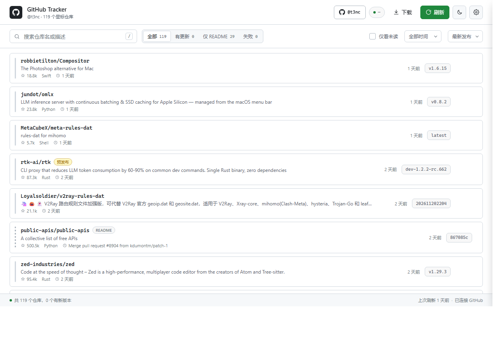
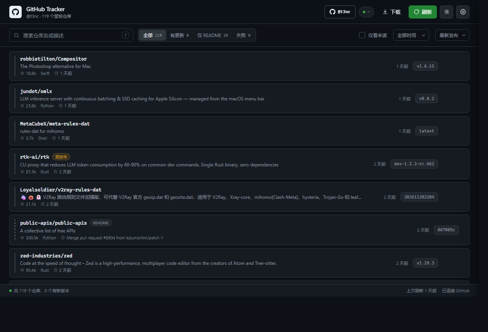
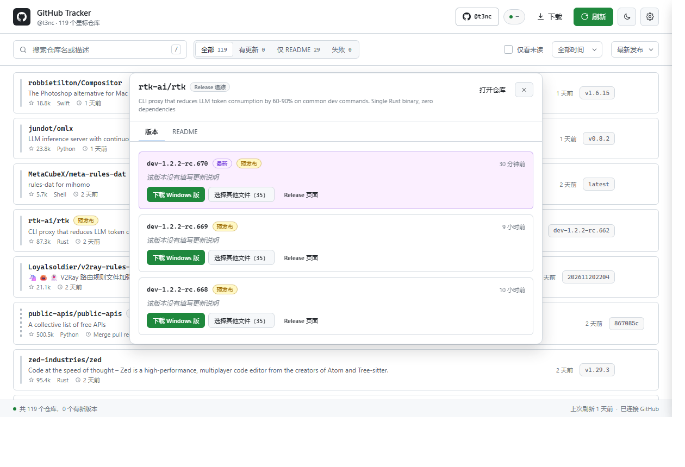
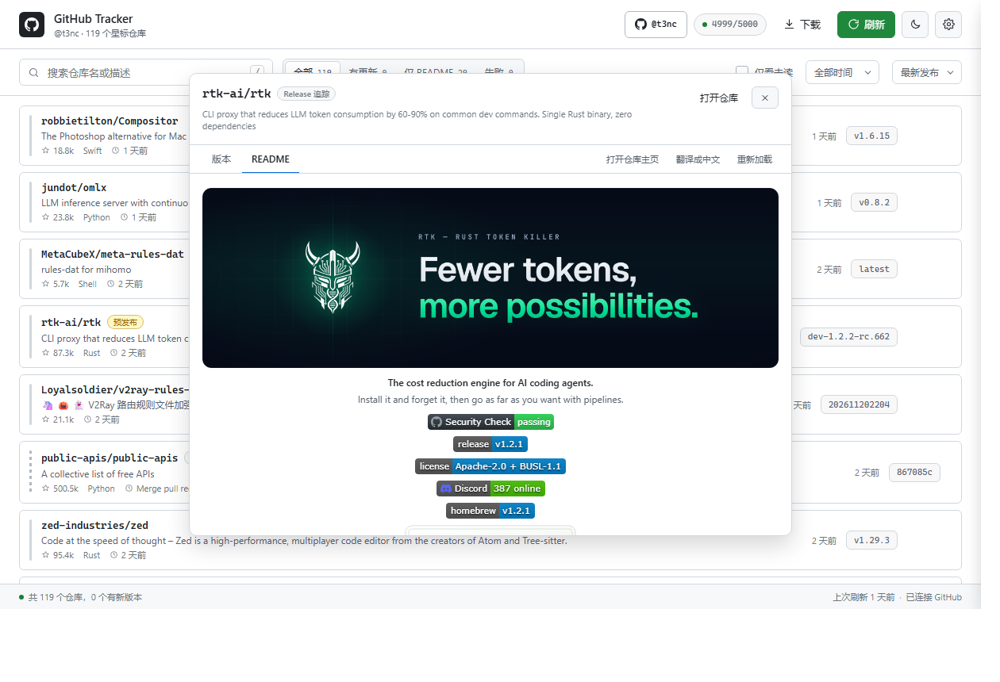

# MyGithubTracker 介绍

> 一个只看 GitHub Star 项目「有没有更新」的 Windows 桌面小工具：自动发现新版本、一键看更新说明、一键下载 Windows 安装包。

单个 exe，双击即用；纯 Go 实现，界面由系统自带 Edge 渲染，不装运行时、不联网上传任何数据。



---

## 它解决什么问题

你 star 了几百个项目，但真正想知道的只有一件事：**哪些仓库最近发了新版本**。
GitHub 的通知不区分 Release，也不方便批量下载。这个工具把「检查更新」这件事收成一张列表：

| 能力 | 说明 |
| --- | --- |
| 星标同步 | 读取你账号下全部 Star 仓库，支持几百个 |
| 版本追踪 | 有 Release 的追最新版本；没有 Release 的自动改追 `README.md` 的提交 |
| 更新标红 | 首次只建立基线，之后版本变化才标记为新版本，不会一上来全是红点 |
| 时间筛选 | 全部 / 24 小时 / 7 天 / 30 天 / 90 天内有更新 |
| 版本详情 | 点击卡片看最近 1–5 个版本的更新说明与附件 |
| README 预览 | 点击仓库名直接看 README，渲染效果与 GitHub 一致（Markdown + 安全 HTML） |
| 一键下载 | 自动匹配 Windows 版资产，也可展开全部文件手选 |
| 内容翻译 | 英文更新说明与 README 一键翻译成中文（AI 接口 / 浏览器内置两种引擎） |
| 明暗主题 | 浅色 / 深色 / 跟随系统 |
| 增量刷新 | 命中 ETag 304 时不计入配额，日常刷新几乎零成本 |
| 代理 | 跟随系统 / 不使用 / 自定义 http(s)、socks5 |

---

## 界面速览

**深色主题**（顶栏可一键切换）：



**版本详情**：最近几个版本的更新说明、附件列表，最新版高亮，可直接下载或打开 Release 页：



**README 预览**：点卡片里的仓库名进入，右侧固定「打开仓库主页 / 翻译成中文 / 重新加载」，长文档滚动时不跟着走：



---

## 快速上手

1. **准备 Token**
   打开 <https://github.com/settings/tokens/new?scopes=read:user&description=MyGithubTracker>，勾选 `read:user`（需要读私有仓库再加 `repo`），生成后复制。

2. **粘贴并保存**
   首次启动会弹出引导窗口，把 Token 粘进去点「保存并开始」。

3. **刷新**
   程序会自动拉取星标仓库并检查最新版本。之后点右上角「刷新」即可增量更新，有变化的仓库会标红并显示「新版本」。

---

## 几个值得知道的细节

- **首次同步只建立基线**：不会把历史版本全部标成「新版本」，避免第一次打开就被红点淹没。
- **「已读」是本地概念**：标记已读、下载完成都会推进基线，不影响 GitHub 上的任何状态。
- **没有 Release 的仓库**：自动追踪 `README.md` 最近一次提交，列表里会显示 `README` 标记与最新提交信息。
- **翻译引擎**：默认走 AI 接口（OpenAI 兼容，需自备 Key）；也可切到「浏览器内置」，用 Edge 自带的本地翻译模型，不消耗配额、不需要 Key（首次需下载中英语言包）。
- **下载**：文件保存在设置里的下载目录，重名自动加 `(1)`、`(2)`，失败自动重试 3 次。

---

## 数据与隐私

所有数据都在本机：

```
%APPDATA%\MyGithubTracker\
├── config.json      # Token、代理、下载目录等配置（权限 0600）
├── state.json       # 各仓库的追踪状态与缓存
├── app.log          # 运行日志
└── window-profile\  # 界面窗口使用的独立浏览器配置目录
```

- 本地服务只监听 `127.0.0.1`，并校验每次运行随机生成的会话令牌与 Host。
- 「打开链接」只允许 GitHub 域名与作者主页；「下载」只允许 GitHub 域名。
- Token 在界面与接口返回中一律脱敏。

---

## 已知限制

- 需要 Windows 与 Microsoft Edge（或 Chrome）；找不到浏览器时回退到系统默认浏览器打开同一页面，功能不受影响。
- 浏览器内置翻译要求 Chromium 138+，首次使用需要联网下载语言包。
- GitHub API 认证额度为 5000 次/小时；工具已做 ETag 增量，通常远低于上限。

---

## 关于

- 作者：**T3nc@YoGo Studio**
- 发布主页：<https://yogo.wang>
- 许可：[MIT License](../LICENSE)
- 图标使用 GitHub 的 Octocat 标识，**本工具为个人非官方项目**，与 GitHub 无隶属关系；该标识版权归 GitHub 所有，仅用于个人工具识别。
